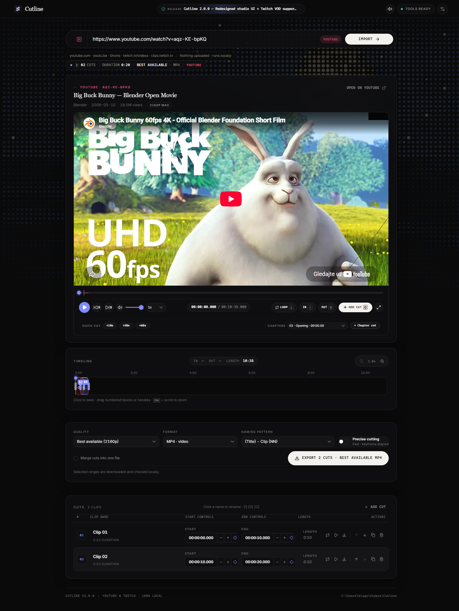

<p align="center">
  
</p>

<h1 align="center">Cutline</h1>

<p align="center">
  Paste a YouTube video or Twitch VOD link. Mark the parts you want. Leave with clean MP4 or MP3 files.
</p>

<p align="center">
  <strong>v2.0.0</strong> &nbsp;·&nbsp; YouTube &amp; Twitch VODs &nbsp;·&nbsp; Windows 10/11 &nbsp;·&nbsp; Tauri 2 &nbsp;·&nbsp; local-first
</p>

---

## What it is

Cutline is a fast desktop clipper for slicing moments out of **YouTube videos** and **Twitch VODs / clips**. It downloads only the sections you choose, keeps every file on your machine, and never asks you to upload anything.

Instead of downloading an entire multi-hour VOD or video just to trim out a 30-second highlight, the player, timeline, and export queue live together in one studio window.

## Screenshots

| | |
| --- | --- |
|  |  |
| Twitch VOD workspace with source-aware accents, draggable timeline ranges, and multi-cut controls. | Layered obsidian dark mode with studio indigo and platform-aware highlights. |

## Install

Grab the installer from `src-tauri/target/release/bundle/nsis/Cutline_2.0.0_x64-setup.exe` after building, or download a release.

Current build: 2,809,890 bytes · SHA-256 `1C52F1161E8AEEC8320DD0ECA4B9EC12C500EDCF83567A7689F62628533F17A2`.

You need:

- Windows 10 or 11 with WebView2
- [yt-dlp](https://github.com/yt-dlp/yt-dlp)
- FFmpeg and FFprobe

The quickest way to get the tools:

```powershell
winget install yt-dlp.yt-dlp
winget install Gyan.FFmpeg
```

You can also point Cutline at tools you already have in Settings. It verifies each path and reports its version before saving.

## Supported links

- **YouTube**: `youtube.com/watch?v=...`, `youtu.be/...`, `youtube.com/shorts/...`, `youtube.com/live/...` (finished broadcasts), or a raw 11-character video ID.
- **Twitch**: `twitch.tv/videos/...`, `m.twitch.tv/videos/...`, `twitch.tv/<channel>/video/...`, `clips.twitch.tv/...`, and `twitch.tv/<channel>/clip/...`.

## Using it

1. Paste a YouTube or Twitch VOD URL — the bar automatically detects the source — and press **Import**.
2. Scrub to a starting point, then press **Mark in** (`I`) and **Mark out** (`O`) — or use `+10s`, `+30s`, or `+60s` for a quick cut.
3. Add as many cuts as you need (`C`). Drag edges on the timeline, nudge by `0.1s`, snap to the playhead, or turn YouTube chapters into cuts.
4. Pick quality, MP4 or MP3, optional **Merge cuts into one file**, and export straight to your output folder.

Each cut is downloaded as its own section with `yt-dlp --download-sections "*HH:MM:SS.mmm-HH:MM:SS.mmm"`. Finished files are verified with FFprobe, and existing filenames receive a `(2)` suffix instead of being overwritten.

If two cuts overlap, the row shows an **OVERLAP** badge and a **Fix / trim** button to trim overlapping ranges cleanly.

## The details

**Unified Player**

- Supports both YouTube videos and Twitch VODs inside a shared studio control deck with buffered scrubber, cut markers, active IN→OUT zone, ±5s skips, volume, loop, and fullscreen.
- Timecodes use `HH:MM:SS.mmm` with tabular numerals for zero jitter.
- Playhead updates use GPU-composited `translate3d` transforms with `ResizeObserver`-cached widths and dirty-checked DOM writes so a paused player does no work per frame.
- If an embedded preview is blocked by the platform or uploader, Cutline shows the poster and an **Open on YouTube / Twitch** button while keeping full timeline marking and local downloading working.

**Cuts and export**

- Multiple cuts with draggable edges, reordering, renaming, duplication, and deletion.
- Chapter-aware navigation and one-click chapter-to-cut conversion when chapters are available.
- Merged cuts are downloaded section-by-section and joined losslessly with FFmpeg's concat demuxer.
- Optional **Precise cutting** uses `--force-keyframes-at-cuts` for frame-accurate starts.
- Non-blocking download queue with concurrency limit, live progress, speed, ETA, cancel, retry, and removal.

**Desktop behavior**

- Frameless studio title bar with minimize, maximize, and close.
- Settings for output folder, default format/quality, concurrency, light/dark studio theme, interface sounds, and explicit tool paths.
- Lazy-loaded Settings panel and memoized workspace components for responsive scrubbing and dragging.
- Animations use GPU-composited `transform` and `opacity` only, and respect `prefers-reduced-motion`.

**Sign-in & Authentication**

Browser cookies are off by default. If YouTube asks for sign-in confirmation or a Twitch VOD is **subscriber-only**, open **Settings → Authentication**, enable cookies for your browser, save, and press **Test**. Cookies are read locally by `yt-dlp` only while enabled — Cutline never stores or displays them.

For YouTube videos that require a Proof of Origin Token, **Install provider** fetches the official `bgutil-ytdlp-pot-provider` release, verifies its checksum, builds it with local Node.js 22+, and runs the helper on `127.0.0.1:4416`. Node.js 22+ is also used by `yt-dlp` for YouTube's JavaScript challenge (`--js-runtimes node` is passed only on YouTube requests).

## Global notice

Edit [`src/config/global-info.json`](src/config/global-info.json) and push it. Installed apps check that file via the GitHub contents API on launch, every five minutes, and when the window regains focus.

```json
{
  "enabled": true,
  "label": "NOTICE",
  "message": "Your message for everyone (240 characters max).",
  "tone": "info",
  "updatedAt": "2026-11-25"
}
```

## Build from source

```powershell
npm install
npm run dev          # frontend only, with a dev mock backend (YouTube & Twitch)
npm run app:dev      # full app with the Rust backend
npm run app:build    # release binary + NSIS installer
```

On Windows with the GNU Rust toolchain and winlibs MinGW:

```powershell
$env:Path = "$env:USERPROFILE\.cargo\bin;.\.setup\mingw\mingw64\bin;$env:Path"
```

## Limits

- Live streams (both YouTube Live and live Twitch channels) cannot be clipped until the broadcast ends and becomes a VOD.
- Without **Precise cutting**, section boundaries align to nearby keyframes.
- Browser cookie databases can stay locked while the browser is running; close the browser and retry if needed.
- Use Cutline only for videos you own or have permission to download.
