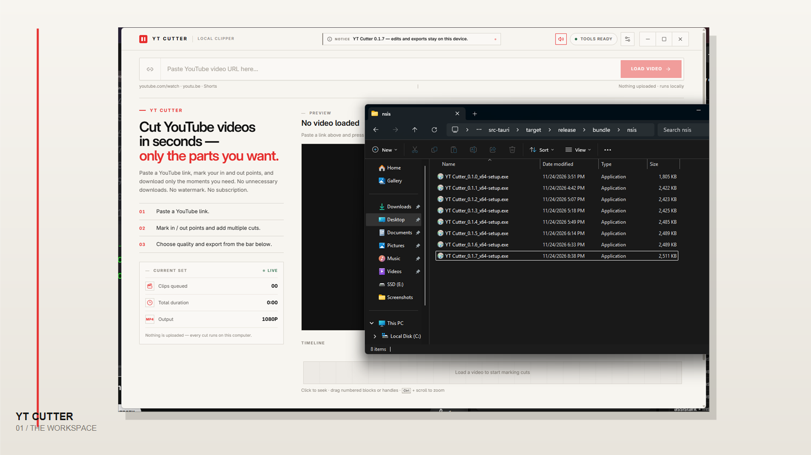
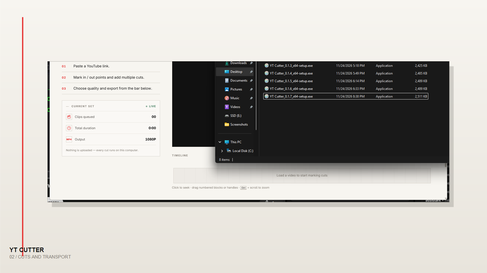

<p align="center">
  
</p>

<h1 align="center">YT Cutter</h1>

<p align="center">
  Paste a YouTube link. Mark the parts you want. Leave with clean MP4 or MP3 files.
</p>

<p align="center">
  <strong>v1.9.0</strong> &nbsp;·&nbsp; Windows 10/11 &nbsp;·&nbsp; Tauri 2 &nbsp;·&nbsp; local-first
</p>

---

## What it is

YT Cutter is a small desktop app for slicing pieces out of YouTube videos. It downloads only the sections you choose, keeps the files on your machine, and never asks you to upload anything.

It started as a way to avoid the usual dance of downloading a full video, scrubbing through it elsewhere, and throwing away 95% of the file. The player, timeline, and export queue live in one window.

## A few screenshots

| | |
| --- | --- |
|  |  |
| In/out points, overlap warnings, chapter cuts, and one-click fixes. | Pure black dark mode with the same controls and red accents. |

The images are captures from the app itself, framed the same way so the paper, ink, and red stay consistent.

## Install

Grab the installer from `src-tauri/target/release/bundle/nsis/YT Cutter_1.9.0_x64-setup.exe` after building, or use an existing release.

Current build: 2,569,623 bytes · SHA-256 `C3091F06BF1724DE4C09EACB5AFFCC66958304A01ACECFD90E67F6D532A502A9`.

You need:

- Windows 10 or 11 with WebView2
- [yt-dlp](https://github.com/yt-dlp/yt-dlp)
- FFmpeg and FFprobe

The quickest way to get the tools:

```powershell
winget install yt-dlp.yt-dlp
winget install Gyan.FFmpeg
```

You can also point YT Cutter at tools you already have in Settings. It checks the paths and shows the version before saving them. Nothing gets installed quietly.

## Using it

1. Paste a YouTube URL and load the video.
2. Scrub to a starting point, then press **Mark in** and **Mark out** — or use `+10s`, `+30s`, or `+60s` for a quick cut.
3. Add as many cuts as you need. Drag the edges, type exact timecodes, or turn a chapter into a cut.
4. Pick MP4 or MP3, choose an output folder, and start the queue.

Each cut is downloaded as its own section with `yt-dlp --download-sections "*HH:MM:SS.mmm-HH:MM:SS.mmm"`. The whole video is not downloaded first. Finished files are checked with FFprobe, and existing names get a `(2)` suffix instead of being overwritten.

If two cuts overlap, the row shows an **OVERLAP** badge and a **Fix / trim** button. Pressing it trims the later cut back to the previous cut's end.

## The details

**Player**

- Custom player with a 52px control deck, buffered scrubber, cut markers, IN→OUT zone, ±5s skips, speed control, volume, loop, and fullscreen.
- Timecodes use `HH:MM:SS.mmm` and tabular numerals, so the numbers stay aligned while they change.
- Playhead movement uses GPU-composited transforms. The width is cached with a `ResizeObserver`; no layout reads happen in the animation frame.
- Embedded player blocked? The app shows the thumbnail and an **Open on YouTube** fallback. Cuts can still be made by typing timestamps.

**Cuts and export**

- Multiple cuts with draggable edges, reordering, renaming, and deletion.
- Chapter-aware navigation and one-click chapter-to-cut conversion when the uploader supplied chapters.
- Merged cuts are downloaded one section at a time and joined with FFmpeg's concat demuxer. yt-dlp only honors the first range when several `--download-sections` flags are passed.
- Optional **Precise cutting** uses `--force-keyframes-at-cuts` for tighter starts. It is slower, so it is off by default.
- Queue with concurrency limit, progress, speed, ETA, cancel, retry, and removal.

**Desktop behavior**

- Frameless title bar with minimize, maximize, and close.
- Settings for output folder, defaults, concurrency, theme, interface sounds, and explicit tool paths with real version detection.
- Interface sounds are on by default. Mute from the topbar or Settings; the choice is saved.
- Animations use transform and opacity only, and they respect `prefers-reduced-motion`.
- Dark mode resolves to true black (`#000000`).

**Sign-in**

Browser cookies are off by default. If YouTube asks for sign-in confirmation, open **Settings → YouTube Authentication**, enable cookies for the browser you use, save, and press **Test**. The test makes a real YouTube metadata request and never stores or displays the cookies.

If a video needs a Proof of Origin Token, **Install provider** fetches the official `bgutil-ytdlp-pot-provider` release, checks its digest and pinned source archive, builds it with local Node.js 22+, and starts the helper on `127.0.0.1:4416`. YT Cutter never stores tokens. See the [official PO Token guide](https://github.com/yt-dlp/yt-dlp/wiki/PO-Token-Guide).

Node.js 22+ is also required for YouTube downloads because yt-dlp uses it to solve YouTube's JavaScript `n` challenge. YT Cutter passes `--js-runtimes node` on YouTube requests.

## Global notice

Edit [`src/config/global-info.json`](src/config/global-info.json) and push it. Every installed app checks that file through the GitHub contents API on launch, every five minutes, and when the window regains focus. A new message appears without a rebuild or reinstall.

```json
{
  "enabled": true,
  "label": "NOTICE",
  "message": "Your message for everyone (240 characters max).",
  "tone": "info",
  "updatedAt": "2026-11-24"
}
```

`tone` accepts `info`, `success`, or `warning`. `enabled: false` shows a quiet **Ready** state. The repo is public so everyone can receive notices, but only the owner can write to it. Users get no composer, dismiss button, or timeout. The last good message is cached for offline use; the bundled copy is the final fallback.

## Build from source

```powershell
npm install
npm run dev          # frontend only, with a dev mock backend
npm run tauri dev    # full app with the Rust backend
npm run tauri build  # NSIS installer
```

This workspace was built with the GNU Rust toolchain and winlibs MinGW because MSVC Build Tools were not installed. Add these to `PATH` for Cargo or Tauri commands:

```powershell
$env:Path = "$env:USERPROFILE\.cargo\bin;.\setup\mingw\mingw64\bin;$env:Path"
```

MSVC is the officially supported Tauri target and is recommended for a normal setup. On GNU, `cargo test` links the test harness with an incompatible manifest; use `cargo check --tests` instead. The app itself builds and runs correctly with GNU.

## Checks I ran

- `npx tsc --noEmit`, `npm run build`, `cargo check --tests`, and `npx tauri build` pass.
- Unit tests cover URL parsing, timecode formatting, filename safety, non-overwriting paths, progress parsing, browser auth arguments, error codes, and yt-dlp version comparison.
- In the packaged app, I loaded a signed-in `Me at the zoo` video, marked cuts, fixed an overlap, added a chapter cut, and downloaded it as `Me at the zoo - Clip 03.mp4` — AV1 + AAC, 5.02s. A merged two-section export also came out as a valid 3.75s MP4.
- The playhead was watched moving from x=2 to x=411 over 8 seconds of a 19-second video. Dark mode was checked in the browser console: `rgb(0, 0, 0)`.
- I pushed a one-line notice change to `global-info.json` and the running app picked it up on its next load. Pushing the original message back restored it the same way.
- yt-dlp checksums, the PO Token provider archives, and a real authenticated section download were all checked against the official releases and YouTube.

## Limits

- Without **Precise cutting**, section boundaries may include a little extra video near keyframes.
- Browser cookie databases sometimes stay locked while the browser is running. Close the browser and try the auth test again.
- Use this only for videos you own or have permission to download.
